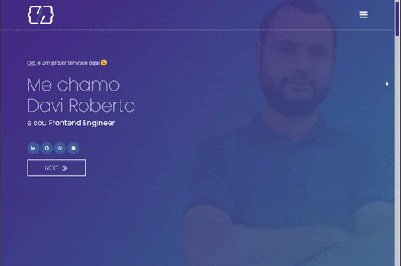

<section align="center">

# Davi Roberto - Full Stack Developer

## Hello, world 💻

This is my personal website, where I share my career in software development.

<a href="https://davifsroberto.github.io" target="_blank">
  
</a>
</section>

## 📖 Guide

1. What I used to develop
2. Necessary
3. Installing the project
4. Running
5. Prettier
6. ESlint
7. Build
8. Info

<br />

## 🚀 What I used to develop

- Next.js
- React
- TypeScript
- Bootstrap
- Styled Components
- Prettier
- ESLint
- Pre-commit with Husky
- And other technologies...
  <br />
  <br />

## ✅ Required

- Node 20.9+ (Node 24 LTS recommended)
- Yarn 1.22.x
  <br />
  <br />

## 📦 Install Dependencies

Run `yarn` for intall dependencies.
<br />
<br />

## 🌐 Development server

Run `yarn dev` for start local server.
<br />
<br />

## 📄 Generate the CV PDFs locally

The downloads are static files. They are generated during development, not when
someone clicks the download button. Python 3.9 or newer is required.

```bash
python3 -m venv .venv-cv
source .venv-cv/bin/activate
python -m pip install -r requirements-cv.txt
python scripts/cv/generate_cv.py
python -m unittest discover -s scripts/cv -p 'test_*.py'
```

The command updates `public/Davi-Roberto_CV.pdf` and
`public/Davi-Roberto_Resume.pdf`. Commit both PDFs when their content changes.
The Portuguese PDF is preserved byte-for-byte when its data matches
`scripts/cv/template.pdf`; the English PDF uses the same two-page layout.

Edit the concise PDF-specific summaries, skills, bullet points and ordering in
`src/locales/cv-pdf/index.json`, in both languages. The generator also reads
the role and technologies from `src/locales/profile/index.json` and
`src/locales/home/banner/index.json`, and the experience titles, companies and
dates, education and contact details from the site's existing locale data.
Experience and education IDs in the PDF data must match those in the site.
The template has fixed space for 10 experiences and up to 3 education entries; the
script reports an error instead of silently cutting off text that does not fit.
Carlito fonts used for edited text are bundled under the SIL Open Font License
in `scripts/cv/fonts/OFL.txt`.

## 📈 Prettier

- Run `yarn run pretty:fix` to format project files using prettier settings.

- Run `yarn run pretty:check` to validate that the files are formatted in the configured prettier pattern.
  <br />
  <br />

## 🛠️ ESlint

- Run `yarn lint` to check if the project is outside an established standard or if it has bugs and problematic code.
  <br />
  <br />

## ⚙️ Build

- Run `yarn build` to generate the production build and static export in `out`.
  <br />
  <br />

## ℹ️ Info:

- Pre-commit: When adding a commit, some checks will be performed to validate the commit before uploading. You can see what these checks are in `package.json - lint-staged`
